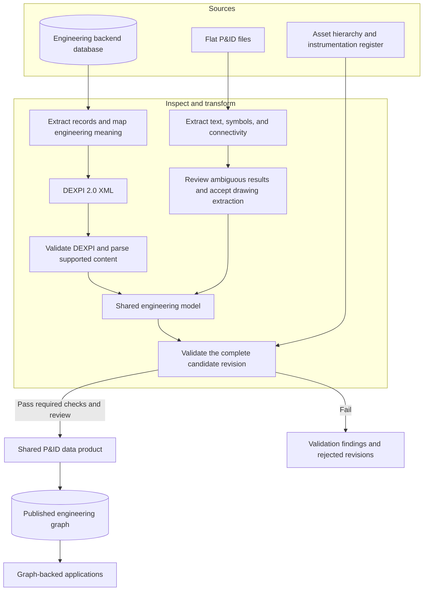
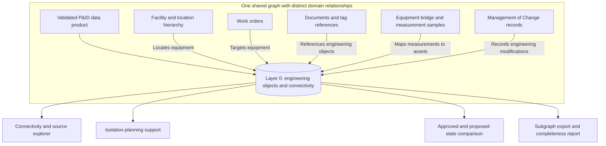

# Proposed architecture

This document describes the confirmed logical architecture, not an existing
deployment. See the [problem statement](PROBLEM_STATEMENT.md) for its purpose
and the [requirements](REQUIREMENTS.md) for acceptance evidence.

## Source authority

A system of authoring is where engineering information is created or edited.
A system of record holds the authoritative information for its declared scope.
These roles can belong to the same system. The graph is a system of reference
for connected queries and analysis; it does not replace source approval.

For the structured demonstration, a representative backend holds engineering
objects, connections, drawing references, and revisions. Its schema and
extraction mappings must be documented. Two synthetic backends follow the
documented storage patterns of SmartPlant P&ID and AutoCAD Plant 3D, using original
names. Neither copies a vendor schema.

Each dataset declares its authoritative source. Where an approved backend
exists, drawing extraction supplies evidence and flags discrepancies without
overwriting that backend. For drawing-only datasets, reviewed extraction
results establish the accepted baseline.

## Ingestion and publication

The shared P&ID data product contains validated engineering objects and
relationships with provenance, stable identifiers, revision metadata, and
review status. It is the publication contract, not a requirement for a
separate platform.

The backend path must demonstrate generating DEXPI from database records.
Importing an existing DEXPI example alone does not satisfy that requirement.
XML validity and engineering fidelity are separate checks.

The flat-file path must interpret connectivity as well as recognize text.
It must retain page regions and uncertain candidates for review. Both paths
use the same engineering definitions and validation rules.

The supported DEXPI subset must preserve equipment, valves, instruments,
pipe segments, connection points, tags, available attributes, and drawing
context, including cross-sheet references. Preserve flow direction only when
the source establishes it. Unsupported source content must be reported. DEXPI export to other
applications requires sufficiently complete supported records and validation;
it is not assumed to follow automatically from successful ingestion.

## Connected domains and applications

Layer 0 is the engineering foundation behind the drawings. Related domains
provide context through explicit relationships and stable identities.
This implements the graph-of-graphs concept within one graph; it does not
require separate graph databases or federation.

The shared vocabulary defines relationship meaning. A work order targeting
equipment differs from a document mentioning its tag. Measurements connect
through an equipment bridge rather than relying on matching tag text alone.
Detailed source-to-graph mappings remain to be specified during implementation.

The layer vocabulary also accommodates process flows, asset maintenance, and
location information. Broader inspection history, turnaround schedules,
engineering specifications, operating procedures, and procurement history
are contextual extension points, not additional required integrations.
Financial and organizational graphs are outside the initial implementation.

These views provide connected engineering information that could support a
digital twin. They do not constitute a live operational twin or simulation.
Relief and flare calculations, process modeling, forecasting, and ML execution
remain potential consumers of exported subgraphs, not implemented engines.

Isolation-planning support is limited to inspecting paths and candidate
boundary valves within a declared analysis boundary. Results must show the
graph revision and source evidence, including gaps in connectivity.
The application must not recommend valve-operating sequences or declare
equipment safe to isolate. Valve suitability, operating conditions, and
approved procedures remain outside the demonstration.

## Changes and historical states

An approved backend revision emits an event that triggers extraction,
DEXPI conversion, validation, and publication. Submitting a flat-file
revision triggers extraction and required review. Full reconciliation
detects changes that event processing missed.

Each declared source revision is a publication unit. A failed mandatory
check blocks the complete update, leaving the previous published state
available. Reprocessing the same revision must not create duplicates.
Missing optional context remains a reported gap.

Approval and publication are distinct. A proposed state begins from a named
approved revision and remains separate from normal approved-state queries.
Recorded approval permits promotion through validation and publication; it
does not bypass either. A synthetic approval does not authorize changes at
a real facility.

Historical reconstruction requires source revisions, transformation versions,
validation results, publication records, and changes to objects and
relationships. Management of Change records explain engineering intent and
approval history. Technical ingestion logs remain separate and link to them.

## Data and technology verification

Public data must have recorded origins and usage terms. Synthetic records
fill missing or insufficient public coverage, including backend records,
revisions, operational context, and controlled failure cases.
Evaluation must identify which results use public data and which use synthetic data.

MILESTONE-001's slice uses Neo4j for the graph and Python with lxml for DEXPI
([LIONG-007](docs/LIONG-007-stack-and-architecture.md)). The rest of the open-source
stack is not yet selected, and PostgreSQL with Apache AGE remains a candidate graph
store; [the decision register](docs/LIONG-REG-001-decisions.md#open-questions-and-package-level-gates)
holds each gate's state. The synthetic backends run on SQL Server, a recorded
exception (DEC-027). The expanded stack assessment considers modern
parsers, vision-language models, and optional segmentation for drawing extraction.
FastAPI and Cytoscape.js are candidates for the application interface.

See [the extraction shortlist](docs/LIONG-007-stack-and-architecture.md#modern-drawing-extraction-candidates)
for LiteParse, LlamaParse, Firecrawl Parse, selected Hugging Face models, and
SAM 3. OpenCV and Tesseract are optional supporting components, not the default
end-to-end extraction architecture. No authoring application is included.

These components do not by themselves provide DEXPI compliance, engineering
symbol interpretation, or a complete authoring system. Verify format support,
licensing, query capabilities, and data fidelity before selecting them.
Storage, event delivery, and deployment choices belong to implementation planning.

The next research tasks are to select usable datasets, test the intended
DEXPI subset, choose one downstream analysis example, and establish
public-data evaluation targets from baseline results.
