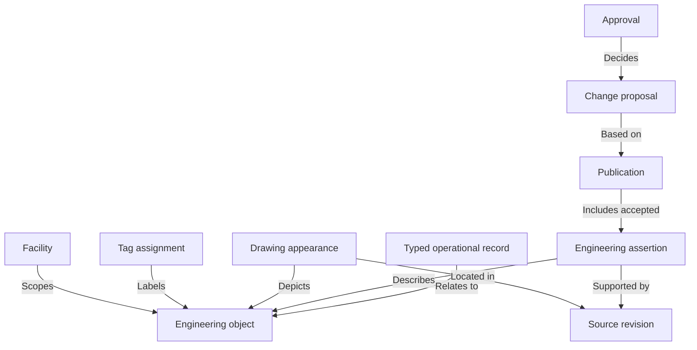

# LIONG-004: Conceptual domain model

Version: 0.1. Status: Draft for review.
Date: 2026-10-05.
Authority: proposed engineering identity, relationships, and source authority.
Dependencies: [LIONG-002](LIONG-002-users-and-requirements.md),
[LIONG-003](LIONG-003-sources-and-ontology.md), [glossary](../GLOSSARY.md).

## Model boundary

This is a proposed conceptual model, not a deployed ontology or database schema.
It refines the approved separation of objects, tags, drawing appearances,
source authority, and published history. External vocabulary mappings remain
bounded proposals in LIONG-003; matching names do not establish equivalence.

The graph represents engineering assertions about a demonstration facility.
It is not direct proof of a physical plant's present condition.

## Concepts

| Concept | Meaning and identity rule | Must remain distinct from |
| --- | --- | --- |
| Facility | Context for equipment identities and tag namespaces | A provider account or repository |
| EngineeringObject | Stable identity of equipment, instrument, valve, pipe segment, or connection point | Its current tag or drawing symbol |
| TagAssignment | A label assigned to an object in a facility and applicable revision/interval | A globally unique object identifier |
| DrawingAppearance | An object's depiction in a drawing revision with a page locator | The object itself |
| SourceArtifact | Immutable captured input, such as an export or drawing | Its filename, which can be reused |
| SourceRevision | A declared source state with a scope and revision identity | Ingestion time or graph publication |
| EngineeringAssertion | A sourced attribute or relationship claim about engineering objects | A bare value with no provenance |
| SourcePolicy | Declared authority and required checks for a dataset and scope | A truth claim inferred from file recency |
| ReviewDecision | Acceptance or rejection of an extraction interpretation | Approval of an engineering modification |
| ChangeProposal | A proposed engineering state based on a named accepted baseline | An unreviewed extraction candidate |
| Approval | A recorded engineering-change decision by an authorized role | A passing validation report |
| Publication | An immutable accepted graph snapshot and its processing provenance | The source system's revision itself |
| ContextRecord | Work order, document reference, measurement, or MOC record | A generic untyped asset link |

Full logical fields belong in [LIONG-005](LIONG-005-data-contracts.md).
The root glossary remains the authority for already agreed terms.

## Relationships

Connectivity relates connection points and pipe segments under a defined source
revision. Cross-sheet references connect appearances or continuation points; they
are not extra physical assets unless the source says so. The mapping must prevent
one physical connection from becoming two independent edges after joining sheets.

Flow direction is a separate sourced assertion. Undirected physical connectivity
does not imply a known process-flow direction. A crossing without a junction symbol
is not automatically a connection.

## Authority rules

1. A dataset declares source authority before ingestion.
2. Where a structured approved backend exists, it governs its declared engineering
   scope. Drawing extraction can contradict it but cannot silently overwrite it.
3. A drawing-only dataset obtains an accepted baseline from reviewed extraction.
4. An instrumentation register can impose a mandatory consistency check without
   silently becoming the owner of every engineering attribute.
5. Mandatory disagreements block publication. Optional missing context stays visible.

Example: a drawing associates a pressure instrument with equipment A while the
instrument register names equipment B. Retain both sourced assertions and a finding.
Do not resolve the conflict by whichever record was ingested last.

## Identity and historical meaning

A tag rename changes TagAssignment, not EngineeringObject identity. Replacing a
physical valve with a different valve may create a new object even when the tag is
reused. Distinguishing replacement from renaming requires source evidence; geometry
similarity or equal text alone is insufficient.

Two facilities may both use `V-101`. Their tag namespaces differ. Two sheets may
depict the same valve; they contribute appearances of one object after a supported
identity match. An uncertain match remains a candidate and cannot silently merge
work orders or measurements.

A functional location is a position or function in the asset hierarchy, not
necessarily the physical equipment occupying it. Work orders must declare whether
they target the location, equipment, or both through separate typed links.

Publication identity preserves what was accepted at a particular processing state.
Effective time records when a fact applies in the modeled world; availability
records when that information could be known. A later correction can change a
current interpretation without rewriting earlier publication receipts.

## Operational context

Use distinct relationships for a work order targeting equipment, a document
mentioning a tag, an instrument measuring an observable property, and a change
record affecting an object. Document mentions need revision-aware resolution:
an old manual's tag is not necessarily the current asset with that label.

The equipment bridge maps a measurement identifier to an asset under a declared
context. A reading needs a quantity, unit, timestamp, and source. A plausible
reading is not proof of an equipment state or an isolation condition.

## Review checkpoint

Review physical-object versus functional-location identity, replacement versus
retagging, cross-sheet continuation, and conflicting register cases before approving
the logical contracts. An ontology mapping must preserve these distinctions.
