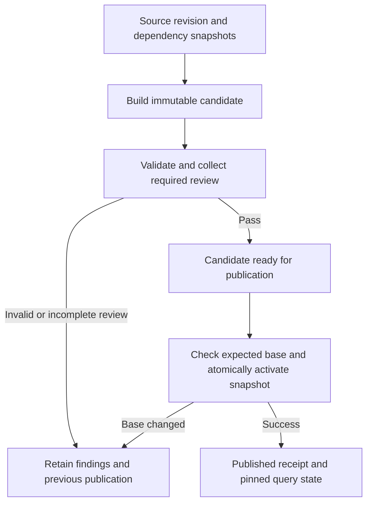

# LIONG-005: Logical data and publication contracts

Version: 0.1. Status: Draft for review.
Date: 2026-10-05.
Authority: proposed logical fields, revision processing, and export contracts.
Dependencies: [LIONG-003](LIONG-003-sources-and-ontology.md),
[LIONG-004](LIONG-004-domain-model.md).

## Contract status

The records below are technology-independent proposals. They are not deployed
tables, complete DEXPI schemas, or a claim of standard compliance. Physical DDL,
XML encodings, graph constraints, and migrations follow only after the applicable
standard and technology gates pass.

Use opaque stable IDs, explicit UTC offsets on timestamps, and immutable artifact
hashes. Illustrative field names are local contracts, not external ontology terms.
No generator-private identity is allowed as an ingestion reconciliation shortcut.

## Logical records

| Record | Required fields | Rule |
| --- | --- | --- |
| SourceManifest | source_id, dataset_id, origin_uri, captured_at, rights_ref, provenance_kind, checksum | A URL alone is not a redistribution grant |
| SourceRevision | revision_id, source_id, facility_id, scope_id, predecessor_id, artifact_refs, approval_ref | State whether input is a complete snapshot or a delta |
| EngineeringObject | object_id, facility_id, object_kind | Tags and attributes live in revision-aware assertions |
| TagAssignment | object_id, namespace, tag_value, revision_id, valid_from, valid_to | Uniqueness applies within declared context and interval |
| EngineeringAssertion | assertion_id, subject_id, predicate, value_or_target, source_locator, revision_id, evidence_status | Relationship targets must resolve; units and direction cannot be guessed |
| DrawingAppearance | appearance_id, object_id_or_candidate, artifact_id, page_id, region, coordinate_system | Record dimensions/orientation needed to locate the evidence |
| IdentityMapping | source_id, source_object_key, object_id, method, review_ref, applicable_revision | Ambiguous matches are not accepted mappings |
| ValidationReport | report_id, candidate_id, profile_version, findings, mandatory_pass, checked_dependencies | Record the exact register snapshots checked |
| ReviewDecision | review_id, candidate_hash, actor_id, role, decision, decided_at, reason | Later candidate edits invalidate earlier acceptance |
| ChangeProposal | proposal_id, base_publication_id, candidate_hash, moc_ref, state | Engineering proposal state is separate from extraction review state |
| Approval | approval_id, proposal_id, candidate_hash, base_publication_id, actor_id, role, decision, decided_at | Does not bypass validation or stale-base checks |
| Publication | publication_id, predecessor_id, source_revision_refs, snapshot_manifest, mapping_version, validation_ref, review_refs, approval_refs, published_at | Immutable receipt for a complete accepted snapshot |
| ProcessingEvent | event_id, source_id, revision_id, event_kind, emitted_at, payload_hash | Duplicate ID with different payload is an error |
| ContextLink | record_id, record_kind, target_object_id, relation_kind, source_locator, applicable_revision | No untyped universal asset relationship |

Null means unknown or not applicable only with an explicit reason. It must not mean
zero, false, or accepted. A baseline import may have no MOC approval reference;
record `baseline_import` rather than creating a fictitious change approval.

For an initial drawing-only baseline, record `engineering_decision=not_applicable`
when no engineering approval exists. Publication and extraction acceptance do not
change that status. To use it as an approved base for a change proposal, obtain
separate source engineering approval and publish a new approved baseline revision.
Its SourceRevision carries the verifiable approval reference; retain the earlier
publication unchanged. This baseline policy is a new proposal pending review.

## Time fields

Where applicable, retain authored time, effective interval, source publication or
availability time, ingestion time, review/approval time, and graph publication time.
Unknown source time remains unknown; capture time is not a substitute.

Example: a correction received at 12:00 says a valve was removed at 09:00. An
11:00 published snapshot remains reproducible as originally known. A later corrected
view may reflect the 09:00 effective removal but must identify the later evidence.
Queries must distinguish “known at publication” from “effective at engineering time.”

## DEXPI mapping boundary

The structured path implements extraction, source-to-DEXPI mapping, validation,
DEXPI parsing, and mapping to the shared graph model. Each stage produces a
manifest and findings. Test preservation of supported meaning, not byte equality
between differently serialized artifacts.

| Local concept | Mapping obligation | Failure behavior |
| --- | --- | --- |
| Equipment, valve, instrument | Select the correct supported DEXPI type and attributes | Report unsupported or ambiguous classification |
| Pipe segment and connection point | Preserve endpoints and the supported topology | Reject dangling mandatory endpoints |
| Drawing appearance and continuation | Preserve sheet membership and cross-sheet resolution | Retain unresolved continuation as a gap, not an invented connection |
| Tag and source identifier | Carry sufficient identity evidence or a documented sidecar mapping | Do not substitute a private generator ID |
| Quantity and direction | Preserve supplied unit and source-established direction | Reject incompatible units; retain unknown direction |
| Provenance and review metadata | Retain in the local manifest where the exchange format does not carry them | Do not claim local extensions are standard DEXPI |

Do not infer the exact DEXPI XML schema from this table. The selected DEXPI 2.0
artifacts, serializer, parser, and validation capability must be verified in
[LIONG-003](LIONG-003-sources-and-ontology.md). Older example encodings do not
automatically establish 2.0 compatibility. Export only the supported, validated
subset and accompany it with a loss/completeness report.

## Revision processing

The source commit and graph publication are separate operations. An approved source
revision can exist while graph processing fails. Report both statuses and lag.
Do not imply a distributed transaction across the source, files, and graph.

Proposed implementation: stage a complete candidate snapshot, validate it, then
atomically activate it with an expected-base check. Every query captures one
publication ID at its start; readers must not combine nodes from one snapshot
with relationships from another. Database-specific mechanics remain a gate.

The processing identity includes source revision, mapping version, validation
profile, candidate content, dependency snapshots, and applicable review decisions.
An identical retry returns the same accepted result. A changed mapping creates a
new processing attempt and must not overwrite the old publication.

Events are notifications, not permission to skip predecessors. Park an out-of-order
delta until its predecessor is available or recover from a verified full snapshot.
A delta must explicitly identify deletions. Missing rows in a partial extract must
not be treated as deletions.

Reconciliation compares the authoritative source snapshot with its published
representation and reports additions, modifications, deletions, and mismatches.
It uses the same validation/publication path as event processing.

## Proposed-state promotion

A proposal names its base publication and a candidate hash. The reviewer accepts
extraction interpretations; the approver decides engineering modifications.
Before publication, check that the candidate, dependencies, approval, and base
still match. A changed base requires revalidation and renewed approval where the
decision context changed, not silent merging.

An accepted proposal must also update or materialize the declared authoritative
source through the documented source workflow. Direct graph mutation is not an
alternative source of engineering authority.

## Operational and export contracts

Work orders retain source IDs and status as recorded, without implying ERP workflow
execution. Measurements retain measurement ID, target, quantity, unit, observed time,
availability time, and source. Documents retain artifact hash and a locator with
enough context to verify the tag reference in that revision.

An ExportManifest identifies the requested analysis profile/version, selection
query and parameters, publication ID, included object/relationship IDs, source
references, units, omitted/unsupported content, missing required inputs, and
checksums of exported files. Include boundary-crossing references as explicit
external or missing inputs, rather than silently truncating the engineering system.

The analysis profile owns required parameters; a graph export does not invent
pressure, temperature, material, or operating limits. Naming the first analysis
profile remains a research gate. No solver execution is required.

## Validation and review

Evaluate these contracts through SCN-001 through SCN-014 in
[LIONG-010](LIONG-010-evaluation.md). Approve publication mechanics only after
testing reader consistency, crash recovery, stale-base rejection, and retry behavior.
Logical schema approval is not evidence those tests have run.
