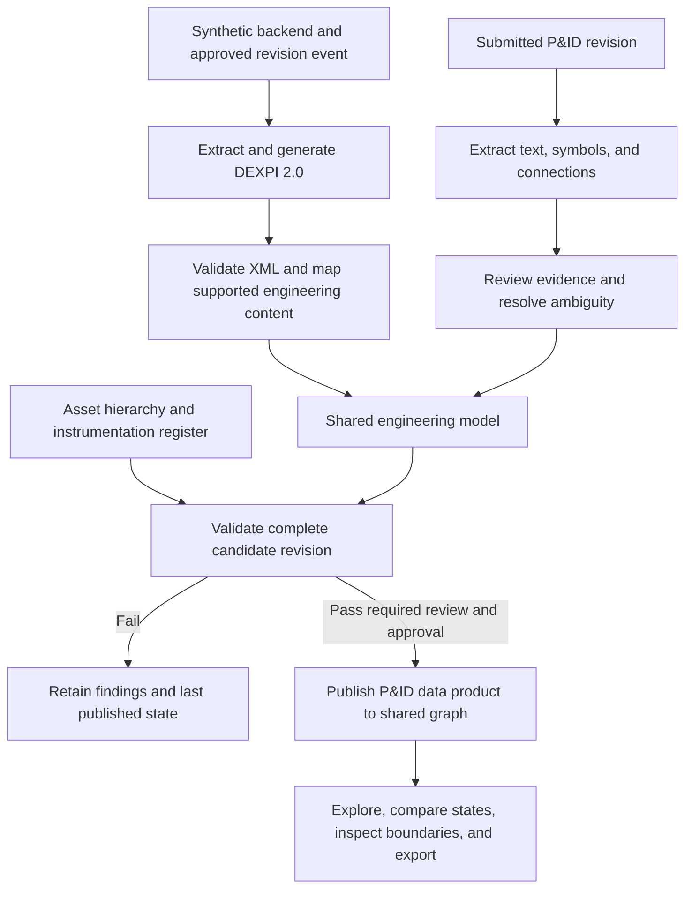
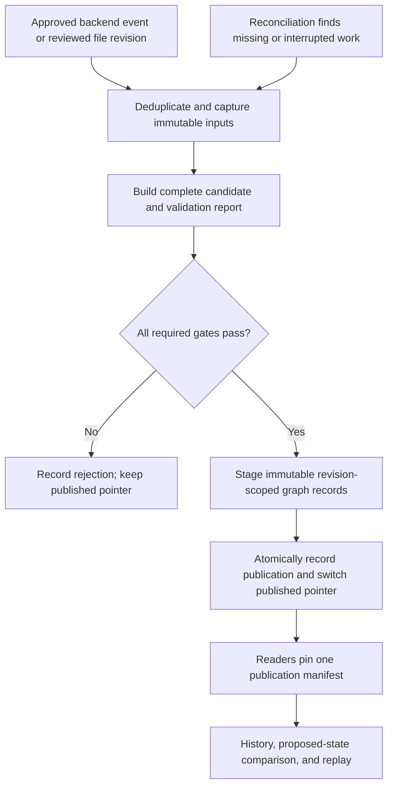

# LIONG-007: Stack and architecture

Status: Draft for review
Version: 0.1
Evidence accessed: 2026-10-05 UTC

## Recommendation and authority

Use a local, self-hostable baseline as the proposed default. Evaluate PostgreSQL for the synthetic backend and control records, Neo4j Community for the shared graph, and a small Python application for conversion, review, publication, and queries. Keep source files and revision artifacts in durable local storage with separate backups. Add remote storage or orchestration only when a demonstrated need justifies it.

Every new technology choice in this document is **Proposed**, including this recommendation. The approved [requirements](../REQUIREMENTS.md), [logical architecture](../ARCHITECTURE.md), and [glossary](../GLOSSARY.md) govern behavior. Apache AGE is an existing candidate, not an approved graph choice. Compare it against Neo4j Community after testing the latter against LIONG's publication and traversal requirements.

LIONG is independent of PPC. No PPC service, repository, ontology release, account, or deployment is a runtime prerequisite. Cloudflare and Databricks Free Edition are explicitly permitted exceptions to the fully-open-source condition. Permission does not require selection, authorize provisioning, or authorize spending.

This document records inspection and proposed design, not a deployed stack, tested integration, performance result, or dependency lockfile. No PPC code was installed or run.

## What the PPC reference establishes

Inspection used PPC commit `01027a84be5d453cbb4e2ea091e4884729918b15`, including its README and PPC-002, PPC-007, PPC-010, PPC-013, and PPC-014. The tree contains documentation, archived documentation bundles, and `.gitkeep` placeholders. It does not provide runnable application code or dependency pins. Its README identifies the current stage as architecture baseline and implementation preparation [REF-TECH-001].

PPC proposes a broad synthetic enterprise, including commercial applications, lakehouse analytics, formal semantics, an operational graph, and agents. LIONG needs a narrower engineering information product. Reuse below means a documented pattern or responsibility, not a working PPC component or permission to copy unverified source.

| PPC component | PPC responsibility | LIONG responsibility | Treatment, Proposed | Rationale | Outstanding version, license, or integration checks |
| --- | --- | --- | --- | --- | --- |
| PostgreSQL | Commercial source records | Synthetic engineering backend; separate control records for revisions, review, identity, and jobs | Adapt | Transactions support approved revisions and durable event records | Inspect PostgreSQL 18.6; pin driver and image; verify restore and outbox behavior |
| Twenty, ERPNext, MySQL, SQLite | CRM, ERP, logistics, refinery source systems | Small synthetic work-order, register, measurement, and change-record fixtures | Exclude from initial stack | Multiple business applications do not prove drawing-to-graph fidelity | No package selection; reconsider only for a named integration |
| Cloudflare R2 | Durable raw evidence and replay; local disk is scratch in PPC | Optional off-machine copy of source artifacts and exports | Adapt, optional | Reuse checksums and replay manifests, not PPC's mandatory remote-storage policy | Standard-tier billing, account limits, credentials, retention, and restore gate |
| Cloudflare Workers and D1 | Edge ingestion/API and workflow state | Local API and transactional review/approval records | Defer | No edge or second workflow store is required | Verify service terms, limits, authentication, and transaction boundaries before any selection |
| Dagster OSS | Assets, sensors, schedules, backfills | Optional job visibility, event polling, reconciliation, and replay | Adapt, optional | Useful when a simple worker no longer makes runs understandable | Inspect 1.13.25 and Apache-2.0; pin integrations; persist instance state; test duplicate launches |
| Debezium and Kafka | Row-level change capture and event transport/replay | Approved-revision event delivery | Defer | A transactional outbox is enough for one synthetic source; row changes are not approval events | No versions selected; approval-envelope mapping and operational burden require evidence |
| AML and Azimutt | Model-as-code and visual structural models | Reviewable schemas and source-to-model mappings | Adapt the practice; defer tools | Structural diagrams do not supply DEXPI semantics | Verify exact AML dialect, export fidelity, component licenses, and versions if adopted |
| DuckDB and DuckLake | Profiling/transforms; integrated analytical history and KPI products | Optional fixture profiling and export checks | Defer DuckDB; defer DuckLake | A lakehouse is unnecessary for the required graph history | Versions, extension licenses, storage semantics, and reproducibility are unverified |
| Jena and Fuseki | RDF/OWL meaning, SHACL validation, SPARQL | Versioned vocabulary and mapping constraints | Adapt separation of meaning; defer services | A vocabulary can start as files; do not create a second operational graph | Pin vocabulary independently; test selected SHACL tooling only if required |
| Neo4j Community | Operational instances and relationship traversal | One shared graph with revision-scoped engineering and connected domains | Adapt; first graph candidate | Direct match for paths, branches, bypasses, and domain subgraphs | Inspect 2026.09.0/GPLv3; test Community constraints, atomic publication, history, backup, and bounded queries |
| OpenMetadata, Great Expectations, OpenLineage, Grafana OSS | Catalog, quality, run lineage, technical health | Ownership, mandatory checks, provenance, job records, failure visibility | Reuse responsibilities; defer platform services | Versioned manifests and application checks can satisfy the first demonstration | Later adoption needs exact versions/licenses; generic quality checks cannot replace engineering checks |
| Plotly Dash | Operational decisions and approvals | Review screen, source regions, graph exploration, state comparison | Adapt as UI candidate | A Python-first interface may reduce initial work | Compare Dash with FastAPI/Cytoscape.js; test graph interactions, review audit, and accessibility; versions not locked |
| Superset | Governed BI | No initial KPI dashboard | Exclude | Connectivity inspection is not enterprise BI | Revisit only with approved analytical scope |
| pgvector, Ollama, LangGraph, Langfuse | Retrieval, LLM execution, agents, agent tracing | None required | Exclude | Review and deterministic publication do not require an agent | No model download, inference service, or external prompt transmission |
| MLflow, StatsForecast/MLForecast, scikit-learn, XGBoost, LightGBM, DoWhy/EconML, PyMC, OR-Tools | Models, forecasting, inference, optimization | Named downstream export contract only | Exclude execution | ML, forecasting, simulation, and engineering calculation engines are deferred | A future consumer must define inputs; export is not a validated calculation |
| Databricks Free Edition | Enterprise-style lakehouse/ML comparison | Optional experiment with copies of approved exports | Defer, permitted provider | Not suitable as the required publication or recovery dependency | Edition-specific connectors, outbound access, quotas, persistence, and terms need verification |
| EIA/NOAA/EPA/PHMSA and other providers | External observations for PPC scenarios | Public engineering evidence with suitable usage rights | Exclude automatic inheritance | PPC's public-data scenario does not establish a LIONG drawing source | Record dataset permissions and provenance individually |

PPC has no equivalent implementation for engineering drawing interpretation or backend-to-DEXPI generation. LIONG must supply adapters, XML generation and parsing, supported-subset validation, and engineering mappings. Drawing work also needs text extraction/OCR, symbol interpretation, line tracing, connection-point matching, cross-sheet resolution, page-region evidence, and review controls. Tesseract, OpenCV, and lxml remain candidates. OCR text alone cannot establish connectivity. Detailed DEXPI tooling and schema decisions belong in [LIONG-003](LIONG-003-sources-and-ontology.md) and [LIONG-005](LIONG-005-data-contracts.md).

## Minimum proposed architecture

The minimum design has one application boundary, a backend/control database, a graph database, and an artifact store. A worker and API can be separate processes in the same codebase. Dagster, Kafka, a catalog server, a lakehouse, and a cloud account are not prerequisites.

| Logical responsibility | Proposed owner | Failure boundary |
| --- | --- | --- |
| Source authority and approved backend revision | PostgreSQL synthetic backend with immutable revision records and an outbox written in the approval transaction | No committed approval means no approved-revision event; extraction must read that revision, not mutable current rows |
| Raw evidence and replay | Local durable artifact directory, content hashes, manifests, and independent backup | A missing or mismatched artifact blocks publication; cloud availability must not decide whether the local demo works |
| Delivery and execution | Persistent worker using the outbox; optional Dagster OSS sensor and scheduled reconciliation | At-least-once delivery is expected; retries use stable revision keys, not assumptions of exactly-once delivery |
| Conversion and extraction | Python adapters, XML tooling, drawing extraction, and review screens | Parse errors, unsupported content, and uncertain matches remain visible; no guessed edges or silent source replacement |
| Shared engineering model | Versioned contracts, identity registry, source mappings, and validation rules | Stable object identity is independent of tags; disputed matches stay unresolved |
| Review and engineering approval | Application role checks and durable decisions | Extraction acceptance and engineering-change approval are separate actions; neither authorizes real isolation |
| Publication and history | Revision-scoped graph data plus immutable manifests and publication receipts | Only a complete validated revision becomes visible; failed writes leave the prior published revision available |
| Read API and UI | One constrained application interface; Dash or FastAPI/Cytoscape.js remains an open choice | All queries select a published or explicitly proposed state; database credentials stay server-side |

Work orders target stable equipment identities. Documents retain their distinct reference meaning and page/region links. Measurements use an equipment bridge with example readings, units, and timestamps. Management of Change records retain reason, affected assets, proposal, approval status, and approval history. Subsequent demonstrated engineering modifications require such a record; technical job logs remain separate.

The graph is a system of reference. For backend-authoritative datasets, extracted drawings can flag discrepancies but cannot overwrite backend facts. Reviewed drawings establish an accepted baseline only for drawing-only datasets.

### Revision-atomic publication and reconstruction

Propose immutable, revision-scoped snapshots for the small demonstration rather than in-place updates that erase history. Graph records identify both the stable engineering object or relationship and its state in a revision. A tag rename changes the tag's applicable revision, not the stable identity. Preserve source IDs, source revision, transformation version, evidence links, review decisions, and validation results.

Staging may use several transactions, but staged records must remain invisible to approved-state queries. Serialize publication per dataset. Check that the expected parent revision is still current, verify the staged candidate, and change its status and published pointer in one graph transaction. Pin the resulting publication ID for every request, including paginated requests.

The graph transaction is the visibility boundary. PostgreSQL job status and artifact storage do not share that transaction. Write and verify immutable artifacts first. Commit a graph publication receipt with the pointer. Then reconcile the control record from that receipt. A crash after graph commit must recover as an already-published revision rather than publish it again.

The candidate identity includes dataset, source revision, and transformation version. Repeated delivery of the same inputs is idempotent. A changed transformation creates a distinguishable candidate; it cannot silently replace an existing publication. Full reconciliation compares authoritative approved revisions against publication receipts, including events missed during downtime.

A proposed state names an approved base revision and has a separate state identifier. Normal published-state queries cannot traverse into proposed or staging records. Promotion requires explicit engineering approval, required extraction review where applicable, and validation. It produces a new publication and retains the proposal and approval history.

For the shared graph, a publication manifest names the revision selected for each connected dataset. Publish all changes in one declared source revision together. Cross-domain links must resolve against the manifest, not whichever revision a later query happens to find. Historical queries and exports use that manifest to reconstruct the same state.

Keep the source artifacts, normalized snapshots, graph snapshots or reconstructible records, mapping versions, validation reports, and publication receipts. Retain removal records and evidence for relationships as well as objects. Rebuild tests must compare stable identities, attributes, edges, and provenance against the original publication. Retention limits and backup recovery objectives remain open in [LIONG-009](LIONG-009-governance-and-operations.md).

### Bounded queries and exports

Every connectivity request names equipment, publication ID, facility or analysis boundary, permitted relationship types, traversal depth, result limit, and timeout. Report truncation and incomplete connectivity explicitly. A missing modeled path is different from insufficient evidence to establish a path. Inspect branches, bypasses, and candidate boundary valves without recommending operating sequences or declaring safe isolation.

Subgraph exports carry stable IDs, available attributes and units, source evidence, the publication manifest, selection criteria, and a completeness report. The report checks one named downstream analysis contract chosen after dataset inspection. Missing physical parameters remain missing. No analysis, ML, forecasting, or simulation engine is required or executed by this design.

## Technology findings and tradeoffs

### PostgreSQL and the operational graph

PostgreSQL provides the proposed transactional backend and control store under the PostgreSQL License. The official versioning page reports 18.6 as the current supported 18.x minor release, with major-version support through 2030-11-14 [REF-TECH-002]. This is inspected evidence, not an installed version. Pin the selected server, driver, and migration tooling together before implementation.

Neo4j Community is the first graph candidate because PPC's operational graph responsibility maps directly to LIONG's paths and relationship queries. Official documentation describes ACID transactions, Cypher, APIs, and single-instance deployment. The inspected `2026.09.0` source license is GPLv3 [REF-TECH-003].

Community lacks Enterprise clustering, failover, online backups, fine-grained role/subgraph access controls, and multiple user databases. Property existence, type, and key constraints also require Enterprise; uniqueness constraints are available [REF-TECH-003]. Therefore:

- Use one database with explicit dataset, state, and revision scoping. Proposed/approved separation is application-enforced, not database-level tenant isolation.
- Keep the database private and expose only validated application operations. Do not offer reviewers unrestricted Cypher or direct database credentials.
- Validate required properties and engineering rules in the publication pipeline. Do not assume Enterprise constraints exist.
- Plan offline dump/restore or tested reconstruction, with downtime documented. Do not claim high availability.
- Pin the Cypher language as well as the server. Current documentation distinguishes Cypher 5 and 25 and describes a changed default in distributed configuration.

These limits are acceptable candidates for a small local demonstration, not proven suitability. GPL obligations, distribution packaging, drivers, optional plugins, and telemetry configuration need review. No APOC, Graph Data Science, Desktop, Aura, or Enterprise capability is implicitly selected.

Apache AGE could reduce the number of database services and simplify SQL/control integration. It introduces extension/server compatibility and graph-query behavior that this inspection has not verified. Keep it as the fallback comparison, not an approved replacement. GATE-TECH-001 must compare atomic visibility, history, bounded traversal, portability, recovery, and operating effort using the same fixtures.

### Orchestration without a streaming platform

Dagster OSS is self-hostable and Apache-2.0 licensed; the inspected release is 1.13.25 [REF-TECH-004]. Its role would be scheduling and observing work, not storing engineering approval or making graph publication atomic. A durable outbox and a small worker are the proposed starting point.

If Dagster is selected, retain its instance state and test sensor restarts, run deduplication, retries, and backfills. Approval occurs in the source transaction; a sensor may detect the resulting event later. Kafka and Debezium add no required behavior until multiple sources or delivery needs justify them. A CDC row event must never be treated as an approved engineering revision by itself.

### Optional Cloudflare storage

Cloudflare R2 Standard currently includes 10 GB-month of storage, one million Class A requests, and ten million Class B requests per month. Direct R2 egress is free [REF-TECH-005]. Above those allowances, Standard storage costs USD 0.015/GB-month, Class A USD 4.50/million, and Class B USD 0.36/million. Billing rounds usage up to its billing units.

The free allowance is not a spending cap. Repeated listing, uploads, reads, and retries consume operations even when stored bytes remain small. Infrequent Access has no free tier, retrieval charges, and a 30-day minimum storage duration. Connected metered services can charge separately despite free R2 egress.

Keep R2 optional for remote artifact copies. Before any account or bucket action, verify payment requirements, current billing controls, account-wide usage, request bounds, and explicit spending permission. Budget alerts must not be described as a proven hard stop. No credentials, endpoint, bucket, or mandatory R2 policy is inherited from PPC.

### Optional Databricks Free Edition

Free Edition is a proprietary, no-cost service permitted by the user's exception. The inspected documentation limits it to non-commercial use and a serverless, quota-limited environment [REF-TECH-006]. It provides no guaranteed reliability, support, or SLA. Current limits include one 2X-Small SQL warehouse and five concurrent job tasks; limits may change.

Outbound internet access is restricted to trusted domains. Custom workspace storage locations and legacy Databricks features are unsupported. General Databricks documentation describes S3, R2, database federation, and other connectors [REF-TECH-007]; it does not establish that every connector or endpoint works in Free Edition. In particular, S3 API compatibility alone does not prove R2 credentials, endpoint routing, Unity Catalog configuration, or Free Edition network access.

Compute can stop for the rest of a day, or in extreme cases a month, when fair-use quotas are exceeded. The inspected page does not give a fixed numeric compute allowance. Data and settings survive quota shutdown, but inactive accounts may be deleted. The service is not described as a fixed-duration trial; that does not guarantee indefinite account or data retention. Feature-specific expiry also exists: the inspected page says Apps stop after 24 hours until restarted.

Do not make Free Edition the source of record, graph host, scheduler, or only recovery copy. An optional experiment could use a small exported fixture after terms and import/export paths are verified. No direct local PostgreSQL, Neo4j, S3, or R2 connectivity is assumed. Record the actual runtime, connector versions, network restrictions, and successful export/restore evidence if that experiment is approved.

## Open implementation gates

All gate proposals remain Proposed. None records a completed benchmark or approval.

| ID | Decision or evidence required | Exit evidence |
| --- | --- | --- |
| GATE-TECH-001 | Choose the operational graph after evaluating Neo4j Community first and AGE as an alternative | Same synthetic cases for branches/bypasses, revision isolation, duplicate delivery, atomic visibility during crash/retry, historical reconstruction, and bounded exports; exact edition/version/license record |
| GATE-TECH-002 | Choose and lock the local package set and deployment shape | Server/driver/tool versions, artifact digests, licenses, platform support, secret handling, and offline recovery procedure; no floating `latest` |
| GATE-TECH-003 | Define publication and event contracts | Approval plus outbox transaction; immutable input capture; concurrent revision conflict policy; duplicate, missed-event, and interrupted-publication tests |
| GATE-TECH-004 | Verify DEXPI subset and drawing tooling | Backend-generated DEXPI 2.0 fixtures, unsupported-content reports, engineering equivalence tests, and independently checked drawing annotations; coordinated with LIONG-003/005/010 |
| GATE-TECH-005 | Decide whether Dagster or other PPC platforms earn their operating cost | A specific requirement the minimal worker cannot meet clearly; pinned OSS integrations and recovery tests |
| GATE-TECH-006 | Approve any Cloudflare use separately | Current terms and billing review, explicit provisioning/spending authorization, bounded request plan, access control, and restore test |
| GATE-TECH-007 | Approve any Databricks Free Edition experiment separately | Non-commercial-use fit; current quota/account limits; edition-specific connector and network proof; persistence/export test; no dependency on service availability |
| GATE-TECH-008 | Select the interface and demonstrate safe query scope | Role-specific review/approval audit, evidence regions, proposed-state exclusion, bounded traversal, clear incomplete/truncated results, and no safety claims |

Follow the [index](LIONG-000-index.md) for the complete documentation set. [LIONG-004](LIONG-004-domain-model.md) owns domain identities and meanings; [LIONG-008](LIONG-008-interfaces-and-workflows.md) owns interface workflows. [LIONG-010](LIONG-010-evaluation.md) defines acceptance evidence. [LIONG-011](LIONG-011-build-runbook.md) must resolve applicable gates before presenting a runnable configuration.

## Version and source evidence

All sources below were accessed on 2026-10-05 UTC. An inspected release is not an implementation lock or a compatibility test. Rolling documentation and hosted-service limits must be rechecked before implementation.

| Reference | Official or pinned source | Exact inspected version or document state | What remains unlocked |
| --- | --- | --- | --- |
| REF-TECH-001 | PPC at commit `01027a84be5d453cbb4e2ea091e4884729918b15`: [README](https://github.com/aadehamid/pearland-petroleum-corporation/blob/01027a84be5d453cbb4e2ea091e4884729918b15/README.md), [PPC-002](https://github.com/aadehamid/pearland-petroleum-corporation/blob/01027a84be5d453cbb4e2ea091e4884729918b15/docs/PPC-002_Enterprise_Architecture_and_Technology_Stack.md), [PPC-007](https://github.com/aadehamid/pearland-petroleum-corporation/blob/01027a84be5d453cbb4e2ea091e4884729918b15/docs/PPC-007_Data_Integration_Event_and_Orchestration_Architecture.md), [PPC-010](https://github.com/aadehamid/pearland-petroleum-corporation/blob/01027a84be5d453cbb4e2ea091e4884729918b15/docs/PPC-010_Ontology_Knowledge_Graph_and_Policy_Architecture.md), [PPC-013](https://github.com/aadehamid/pearland-petroleum-corporation/blob/01027a84be5d453cbb4e2ea091e4884729918b15/docs/PPC-013_Cloudflare_R2_Durability_and_Project_Storage_Standard.md), [PPC-014](https://github.com/aadehamid/pearland-petroleum-corporation/blob/01027a84be5d453cbb4e2ea091e4884729918b15/docs/PPC-014_Implementation_Roadmap_and_Build_Runbook.md) | Exact repository commit; architecture documentation, not implemented packages | All PPC product versions and integration claims require independent verification |
| REF-TECH-002 | PostgreSQL [version policy](https://www.postgresql.org/support/versioning/) and [license](https://www.postgresql.org/about/licence/) | Page reports 18.6; PostgreSQL License | Local server artifact, driver, platform, and migrations |
| REF-TECH-003 | Neo4j [edition comparison and versioning](https://neo4j.com/docs/operations-manual/current/introduction/), [legal overview](https://neo4j.com/licensing/), [2026.09.0 license](https://github.com/neo4j/neo4j/blob/2026.09.0/LICENSE.txt) | Manual 2026.09; exact tag 2026.09.0 license inspected, GPLv3 | Binary digest, driver, Java/runtime requirements, Cypher choice, packaging and integration tests |
| REF-TECH-004 | Dagster [OSS deployment](https://docs.dagster.io/deployment/oss), [1.13.25 release](https://github.com/dagster-io/dagster/releases/tag/1.13.25), [license at that tag](https://github.com/dagster-io/dagster/blob/1.13.25/LICENSE) | 1.13.25, released 2026-10-01; Apache-2.0 | Adoption, Python version, integrations, persistent instance configuration |
| REF-TECH-005 | Cloudflare [R2 pricing](https://developers.cloudflare.com/r2/pricing/) | Rolling service page, updated 2026-10-01; Standard and Infrequent Access distinguished | Service terms/account billing, SDK, S3 subset, authorization, and cost controls |
| REF-TECH-006 | Databricks [Free Edition](https://docs.databricks.com/aws/en/getting-started/free-edition) and [limitations](https://docs.databricks.com/aws/en/getting-started/free-edition-limitations) | Rolling service pages, updated 2026-09-11 and 2026-09-29 respectively; no fixed runtime inspected | Actual account entitlement, runtime, numeric compute quota, connector availability, retention period, and network access |
| REF-TECH-007 | Databricks [data-source and service connections](https://docs.databricks.com/aws/en/connect/) | General AWS platform documentation, updated 2026-09-11; not Free Edition certification | S3/R2 and other connector compatibility in Free Edition remains an implementation gate |

Python, lxml, OpenCV, Tesseract, Dash, FastAPI, Cytoscape.js, and Apache AGE have no exact inspected dependency versions in this document. Their presence in a candidate list is not evidence of selection, license verification, or DEXPI compatibility. Resolve those checks before publishing an executable build plan.
