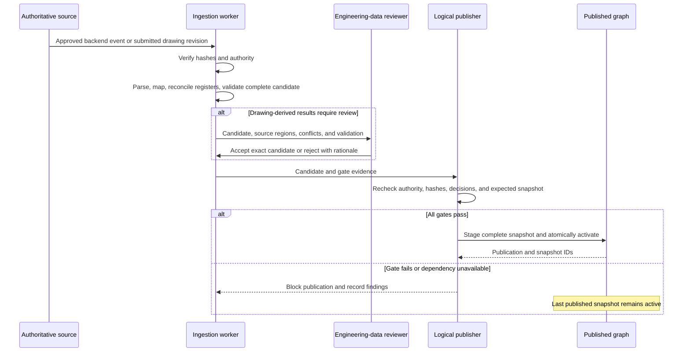

# LIONG-008: Interfaces and workflows

Version: 0.1
Status: Draft. All new interfaces, controls, and workflow details are Proposed, pending user review. Nothing in this document is configured or tested.

## Purpose and authority

This document proposes how users inspect evidence, accept extraction results, approve engineering modifications, and query published information. It follows the confirmed [requirements](../REQUIREMENTS.md), [glossary](../GLOSSARY.md), and [logical architecture](../ARCHITECTURE.md).

The engineering-data reviewer is the primary user. The maintenance or process engineer consumes published information. The engineering-change approver has a separate authority. One person may hold both reviewer and approver roles in the demonstration, but every action records the role used. Neither role authorizes real-world isolation.

LIONG is independent of PPC. These interfaces require no PPC application or service. Public or clearly labeled synthetic data are the only proposed inputs. No services have been provisioned.

The [data contracts](LIONG-005-data-contracts.md) own field definitions and validation contracts. This document owns interactions and authorization preconditions. The [stack and architecture](LIONG-007-stack-and-architecture.md) owns technology choices. The [governance and operations proposal](LIONG-009-governance-and-operations.md) owns runtime controls. Decisions that need approval belong in the [decision register](LIONG-REG-001-decisions.md).

## State visible to every user

Proposed interfaces distinguish source approval, extraction acceptance, validation, and publication. A single green status cannot represent all four.

| Concept | Proposed interface rule |
|---|---|
| SourceArtifact and SourceRevision | Display the immutable artifact and revision identifiers, content hash, declared authoritative source, and public or synthetic origin. |
| Engineering object | Navigate by stable Object identity. Show facility/tag aliases and their applicable revisions separately from identity. |
| Versioned assertion | Show the asserted attribute or relationship, its source revision, supporting page region or backend record, and any uncertainty. |
| Candidate | Show the complete source revision under review, mapping version, validation profile, run, unresolved findings, and extraction acceptance status. |
| Publication | Identify the source revision, mapping version, validation profile, and review decision separately from the source itself. Show content hashes and the published graph snapshot ID. |
| Proposed state | Show its named published baseline, explicit engineering approval evidence, proposed changes, Management of Change record, and decision history. An accepted extraction is not approval evidence. |
| Published state | Show the pinned graph snapshot ID, source revisions, publication time, and remaining reported gaps. Publication time is not source approval time. |

Reprocessing an immutable source revision with a new mapping or validation profile creates a distinct candidate publication context. It does not overwrite the source revision. Changes to candidate content invalidate acceptance of the old content.

A graph query resolves a selected published state to one snapshot ID before execution. Pagination, linked queries, exports, and analysis use that same ID. A response shows if a newer snapshot exists without silently switching to it. An unavailable historical snapshot produces an explicit failure, not a fallback to current data.

## Browser-based reviewer experience

The proposed review workspace puts three views beside each other. The source view opens the original page and highlights the drawing region. The candidate view shows objects and connections. The findings view shows conflicts, unsupported content, ambiguous matches, and validation failures. Selecting one item highlights the corresponding evidence in the other views.

For backend inputs, the evidence view opens the source record and generated DEXPI representation. For drawing inputs, it opens the page region and extraction evidence. A missing locator appears as a provenance gap. The interface does not substitute an unrelated page or guess a connection.

The reviewer can filter by drawing, facility, tag, object type, or finding. Every match shows stable identity and revision context. Ambiguous asset matches stay unresolved until the reviewer records supporting evidence. A tag rename changes an alias, not the object identity. Cross-sheet connections show both drawing appearances and their evidence.

The published-state list and proposed-state list are separate views. The default
consumer view contains published information with its engineering-decision status
shown explicitly. An initial drawing baseline may be published with
`engineering_decision=not_applicable`; it must not be labeled engineering-approved.
Subsequent engineering modifications require approval before publication.
Only reviewers and approvers with proposal-read permission can compare proposed
states. Both proposal and baseline identifiers remain visible.

The reviewer sees separate actions for accepting extraction, rejecting extraction, requesting evidence, and submitting a proposed modification. The engineering approval action appears only for an assigned engineering-change approver. Hiding a button is not an authorization control. The service checks authority on every request.

Before accepting extraction, the reviewer sees the candidate hash, unresolved findings, mandatory validation results, source authority, and mapping version. Acceptance records what was reviewed and the active role. It cannot waive a mandatory check. If the candidate changed after the page loaded, the service rejects the action and asks the reviewer to reload.

The maintenance or process engineer can inspect work orders and recorded statuses, document regions, measurement samples, and Management of Change history. Measurements show units, timestamps, and equipment bridge evidence. A document mentioning a tag does not become a work order targeting that asset.

For isolation exploration, the interface displays the selected equipment, analysis boundary, snapshot, paths, branches, bypasses, and candidate boundary valves. It distinguishes "no path in this validated model" from "connectivity unknown." Unknown information never appears as "safe." The interface offers no valve-operating sequence and makes no isolation authorization claim.

## Proposed API and tool catalog

These routes illustrate contracts, not an implemented API or a required web framework. A local command-line tool may use the same application operations. The browser and tools do not write graph tables directly.

Every operation requires an assigned role within the dataset scope. Read permission does not expose evaluation truth. The following role names refer to the proposed [permission model](LIONG-009-governance-and-operations.md#roles-and-actions).

| Operation | Allowed caller and exact preconditions | Proposed result and repeat behavior |
|---|---|---|
| `POST /datasets/{id}/source-revisions` | Engineering-data reviewer or scoped ingestion worker. Dataset authority is declared, license intake passed, artifact hash is supplied, and revision identity is immutable. A backend claim includes a verifiable approved source event. | Record the source revision and start or locate an ingestion run. The same request key and body return the same receipt. Reusing a revision identity with different bytes fails. |
| `GET /runs/{run_id}` | Reviewer, approver, or operator with scoped run-read permission. The run belongs to the permitted dataset; an operator receives technical status, not reviewer-only evidence. Consumers have no access. | Return role-permitted stage, findings, source revision, and correlation IDs. Read-only. |
| `GET /candidates/{id}/evidence` | Reviewer or approver with dataset read permission. The candidate exists and the evidence is permitted for that role. | Return source locators, candidate hash, register checks, and unresolved findings. Read-only. |
| `POST /candidates/{id}/corrections` | Engineering-data reviewer. Request pins the current candidate hash and supplies corrected assertions, source evidence, and rationale. Corrections cannot change backend-authoritative facts. | Append a new candidate version and require validation and renewed acceptance. Preserve automatic output. Same key and body return the same correction. |
| `POST /candidates/{id}/review-decisions` | Engineering-data reviewer. Request names the current candidate hash, source revision, mapping version, validation profile, and expected review state. Acceptance requires all mandatory checks to pass and required ambiguities to be resolved. | Append acceptance, rejection, or request for evidence with rationale. Never modify an existing decision. Duplicate key and body return the original decision. |
| `POST /datasets/{id}/reconciliations` | Scoped operator or ingestion worker. Declared authority is readable and the request identifies the source scope and comparison checkpoint. | Create or locate a reconciliation run. Discovered revisions use normal ingestion gates. Duplicate key and body return the original run. |
| `POST /proposals` | Reviewer with proposal permission. Request identifies a published baseline with explicit source engineering approval, affected stable object identities, proposed source changes, and a Management of Change record. Extraction acceptance alone is insufficient. | Create a separate proposed state. Repeat requests return the same proposal. No approved graph mutation occurs. |
| `GET /proposals/{id}/comparison` | Reviewer or approver with explicit proposal-read permission. Request selects the proposal, candidate hash, and named baseline publication. Consumers have no access. | Return additions, removals, changed connections, and gaps without joining them into default published-state results. Read-only. |
| `POST /proposals/{id}/engineering-decisions` | Assigned engineering-change approver. Request identifies current proposal hash, baseline snapshot, source revision, and Management of Change record. The baseline and proposal match the reviewed versions. | Append approval or rejection with rationale and active role. An extraction acceptance alone does not satisfy this operation. |
| `POST /publications` | The single logical publisher role only. Exact candidate hashes and required review/approval records match. Mandatory validation passes. Expected active snapshot and proposal baseline are current. Source authority is established. | Stage a complete snapshot and atomically activate it. The publication identity returns the same publication on replay; differing content for that identity fails. |
| `GET /snapshots/{id}/objects/{object_id}` | Reviewer, consumer, or approver with dataset read permission. The snapshot is published and the object is in scope. Proposed content requires a separate explicit proposal query. | Return versioned assertions, contextual tag aliases, evidence, and connected-domain links at the pinned snapshot. Read-only. |
| `POST /snapshot-queries` | Reviewer, consumer, or approver with dataset read permission. Request pins a published snapshot, stable asset identity, bounded query type, and analysis boundary. | Return connectivity or isolation-exploration evidence and completeness limits. Semantically read-only; repeating the same query against the same snapshot uses the same data. |
| `POST /exports` | Reviewer, consumer, or approver with export permission. Request pins snapshot, selection criteria, output format, and named downstream input profile. Redistribution terms permit the selected output. | Create or locate an export manifest and completeness report. DEXPI output additionally requires supported and sufficiently complete records. Same key and body return the same export. |

An operator cannot use recovery or reconciliation to accept extraction or approve engineering changes. An approver does not gain extraction acceptance merely by being an approver. A person assigned both roles chooses the role for each decision.

### Request identity and failures

Proposed mutating requests carry an idempotency key, request ID, actor identity, active role, dataset scope, and expected state or revision. The service assigns a run ID for asynchronous work. It returns the request ID, run ID where applicable, and resource identifiers. Each stage records its parent request and run. Engineering decision IDs and publication IDs remain distinct from technical run IDs.

Idempotency keys are scoped to the authenticated actor, dataset, and operation. The service stores the canonical request hash with the outcome. The same key and body return the prior receipt even when work is still pending. A different body with that key fails. Authorization is checked again before returning a prior result. Natural revision and publication uniqueness checks remain effective after transport retries or key expiry.

| Proposed status | Meaning and caller response |
|---|---|
| `400` | The schema or required field is invalid. Correct the request before resubmission. |
| `403` | The actor lacks authority or cannot establish the required role/scope. Do not retry with a claimed role in the payload. |
| `409` | The expected source revision, candidate, approval, or baseline is stale, or an idempotency key conflicts. Reload and review the changed state. |
| `422` | A mandatory engineering, provenance, or completeness validation fails. Show structured findings; do not publish partial results. |
| `503` | A required service or source is unavailable. Preserve the last published state and retry with the same request identity. |

An asynchronous acceptance receipt is not a publication success response. Polling the run returns its eventual status and findings. A timeout leaves the outcome unknown to the caller until it checks the run or repeats the idempotent request. Error details exclude credentials and inaccessible evaluation material.

## Manual review and publication sequence

The proposed publisher activates only complete validated snapshots. There is no global transaction joining source approval and graph activation.

An approved source revision may therefore be newer than the active graph. The interface shows this lag explicitly. Reconciliation discovers missed source events and sends those revisions through the same gates.

## Use cases

### UC-001: Ingest a backend revision

The scoped ingestion worker consumes an approved synthetic backend event. It captures an immutable source revision, generates DEXPI, and validates the supported DEXPI 2.0 subset. It maps engineering meaning into the shared model and checks the declared asset hierarchy and instrumentation register.

The publisher evaluates the complete candidate and its authority. If checks pass, it activates one published snapshot. If any mandatory check fails, the prior snapshot remains active and the run exposes the rejected revision and findings. An existing DEXPI import alone does not satisfy the backend demonstration. This use case covers REQ-001, REQ-003, REQ-004, REQ-006, REQ-007, and REQ-008.

### UC-002: Review a drawing revision

The reviewer submits a licensed public or synthetic drawing revision. Extraction proposes objects, tags, connection points, and connectivity with page regions. The reviewer checks uncertain candidates, unsupported content, cross-sheet evidence, and register conflicts.

For a drawing-only dataset, accepted extraction forms the accepted baseline after validation and publication. For a backend-authoritative dataset, discrepancies become findings or source-change proposals. The reviewer cannot overwrite the backend by correcting a graph edge.

Proposed baseline policy: an initial drawing-only import records engineering
approval as `not_applicable`. Before it can be the approved base for UC-004, obtain
a distinct approver decision in the authoritative source and publish that approved
baseline revision through normal ingestion. Retain the original publication;
never relabel its earlier review acceptance as engineering approval.

Corrections produce versioned candidate assertions with rationale and evidence. They remain separate from the untouched automatic extraction output. Changed candidates require validation and renewed acceptance. This use case covers REQ-002, REQ-003, REQ-004, REQ-005, REQ-006, and REQ-016.

### UC-003: Reconcile and publish

An operator requests comparison of source revision inventory with recorded ingestion and publication outcomes. The run lists missing, repeated, failed, and pending revisions. It does not treat a failed revision as published or silently skip it to report success.

Missing work follows the normal ingestion sequence. Duplicate events locate prior outcomes instead of creating duplicate objects or publications. Publication uses a conditional update of the expected active snapshot. Concurrent or stale attempts fail without mixing candidate revisions. This use case covers REQ-007, REQ-008, REQ-010, and REQ-017.

### UC-004: Approve a proposed modification

1. The reviewer selects a named published baseline and verifies its distinct source engineering approval before creating a proposal.
2. The reviewer records source changes, affected assets, and a synthetic Management of Change record.
3. The worker builds a separate candidate and produces a baseline-to-proposal comparison.
4. The reviewer accepts extraction where the path requires it.
5. The assigned engineering-change approver reviews the exact proposal, baseline, evidence, and Management of Change record.
6. The approver records an engineering decision under the approver role.
7. The publisher checks current authority, required validation, review decisions, approval, and the expected baseline before activation.

If the baseline, proposed content, or applicable approval changes, promotion stops. The reviewer creates an updated proposal against a named current baseline and obtains renewed review and approval. The system does not auto-merge engineering modifications or reuse stale approval.

Before graph promotion, the proposal must update or materialize the declared authoritative source. Where the backend is authoritative, engineering approval must be reflected in the approved source revision and its event before publication. For drawing-only inputs, the approved proposed source revision and accepted extraction supply the source evidence. Initial baseline import may omit a Management of Change record. Subsequent demonstrated engineering modifications require one. This use case covers REQ-003, REQ-008, REQ-009, and REQ-010.

### UC-005: Explore asset connectivity and candidate isolation

The maintenance or process engineer selects an asset by stable identity and pins a published snapshot. The query declares the analysis boundary and reports paths, branches, bypasses, candidate boundary valves, and missing connectivity. It includes supporting source evidence.

The engineer can open connected work orders, document regions, measurement samples through the equipment bridge, and Management of Change records. Ambiguous external links stay unresolved. Missing operating conditions and valve suitability remain outside the result, not assumed acceptable. This use case covers REQ-005, REQ-011, and REQ-012.

### UC-006: Export an analysis-ready selection

The consumer selects a snapshot, assets, relationships, and a named downstream input profile. The export contains stable identifiers, attributes, units, evidence, revision information, selection criteria, and a completeness report. Missing physical inputs appear explicitly.

The manifest identifies approved or proposed content. Proposed exports require explicit proposal selection and cannot masquerade as published approved information. DEXPI export reports unsupported information and blocks a compliant-export claim when required supported information is incomplete. The export prepares inputs; it does not execute or validate an engineering calculation. This use case covers REQ-004, REQ-013, REQ-014, and REQ-018.

## Review and acceptance evidence

The following are Proposed checks for the [evaluation plan](LIONG-010-evaluation.md) and [build runbook](LIONG-011-build-runbook.md), not test results.

| Check | Required evidence |
|---|---|
| Authority and role separation | Under SCN-013, a reviewer-only caller receives a denial for engineering approval. A dual-role actor records separate actions and roles. |
| Replay and uncertain responses | Under SCN-014, duplicate delivery and retry after a timeout return the same publication identity without duplicate objects. |
| Evaluation isolation | Under SCN-015, worker and reviewer requests cannot retrieve held-out truth through source evidence, error details, exports, or run logs. |
| Browser review | A drawing region, candidate assertion, and conflict refer to the same immutable source revision. Stale acceptance fails. |
| Publication visibility | Readers see the complete prior or complete next snapshot during activation, never a mixture. |
| Proposal separation | Default queries exclude proposals. Stale baseline or stale approval prevents promotion and requires re-review. |
| Safety limits | Bypass and incomplete-connectivity cases display evidence and uncertainty without declaring safe isolation. |
| Export traceability | An export can be traced to its snapshot, selection, source hashes, transformation versions, review evidence, and completeness profile. |

Open review choices are the route naming, authentication mechanism, role assignment procedure, browser layout, query limits, and export profile. Field-level definitions remain in LIONG-005 rather than being independently specified here.
